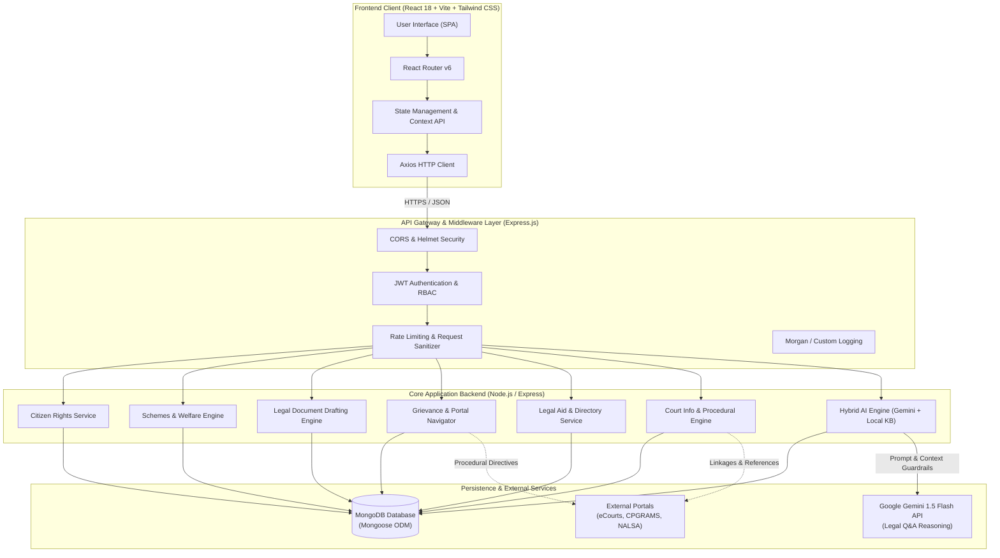
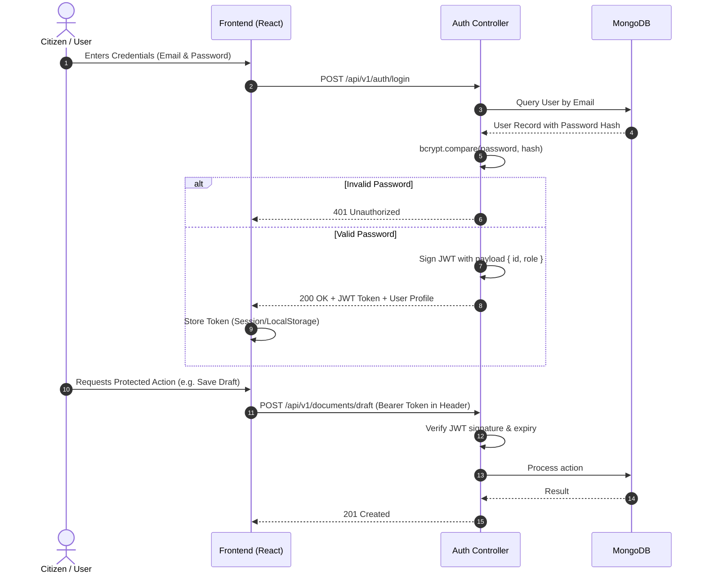
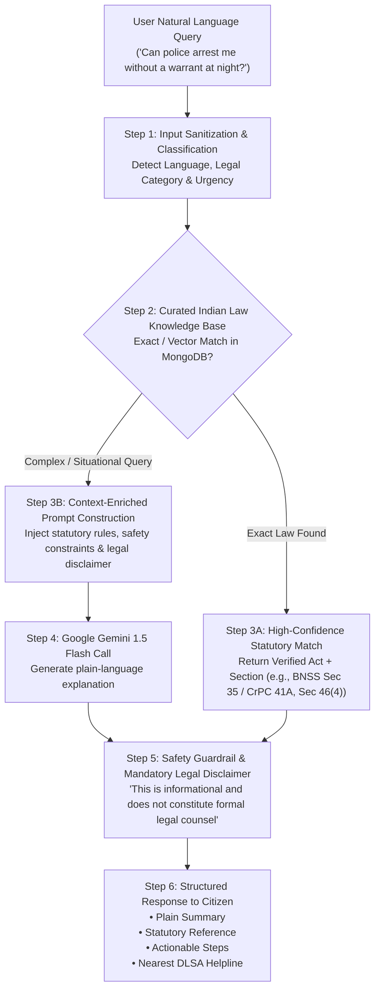

# NyayaSetu System Architecture

This document provides an in-depth architectural breakdown of **NyayaSetu**, an AI-powered legal empowerment and government services access platform tailored for Indian citizens.

---

## 1. High-Level Architecture Overview

NyayaSetu is architected as a modern, decoupled **3-tier Client-Server Web Application** utilizing the **MERN** stack (MongoDB, Express.js, React.js, Node.js).



---

## 2. Component Tier Breakdown

### 2.1 Presentation Tier (Frontend)
- **Framework**: React 18 with Vite for ultra-fast HMR and bundle optimization.
- **Styling**: Tailwind CSS with custom thematic design system reflecting Indian judicial neutrality and accessible civic design.
- **Iconography**: Lucide React for consistent, lightweight vector iconography.
- **State Management**: React Context API for global session state (User Profile, Language Preference, Theme) and local state for modular interactions.
- **Routing**: `react-router-dom` v6 with Protected Route guards for role-restricted panels (Citizen, Legal Aid Provider, Administrator).

### 2.2 Application / Logic Tier (Backend)
- **Runtime**: Node.js (v18+ LTS) configured with native ECMAScript Modules (`"type": "module"`).
- **Web Framework**: Express.js with a modular controller-service-router pattern.
- **Security Middleware**:
  - `helmet`: Secures HTTP response headers.
  - `cors`: Restricts cross-origin resource sharing to configured client origins.
  - `express-rate-limit`: Prevents abuse on conversational and drafting endpoints.
  - `mongo-sanitize`: Guards against NoSQL query injection.

### 2.3 Data Persistence Tier
- **Database**: MongoDB (v6.0+) utilizing Mongoose ODM.
- **Indexing**: Full-text indexes on legal rights acts, keyword tags, category taxonomies, and eligibility rules.
- **Integrity**: Schema-level validations, default values, and relational population references.

---

## 3. Database Schema Overview

The database design organizes Indian statutory laws, welfare schemes, drafting templates, and citizen queries cleanly:

```mermaid
erDiagram
    USER ||--o{ CHAT_LOG : initiates
    USER ||--o{ GRIEVANCE_TRACKER : creates
    USER ||--o{ DRAFTED_DOCUMENT : owns
    LEGAL_AID_CLINIC ||--o{ LAWYER : associates
    SCHEME ||--o{ SCHEME_CATEGORY : belongs_to
    RIGHT ||--o{ RIGHT_CATEGORY : classified_under

    USER {
        ObjectId _id PK
        string fullName
        string email UK
        string passwordHash
        string role "citizen | legal_aid | admin"
        string state
        string preferredLanguage
        date createdAt
    }

    RIGHT {
        ObjectId _id PK
        string title
        string category "Constitutional | Consumer | Labor | Women | Cyber | Criminal"
        string relevantAct "Constitution of India | BNS 2023 | IT Act 2000 | etc."
        string sectionOrArticle "Article 21 | Section 43A | etc."
        string simplifiedSummary
        string detailedExplanation
        string[] citizenRightsPoints
        string[] remedySteps
        string[] penaltyForViolation
        string[] tags
        date updatedAt
    }

    SCHEME {
        ObjectId _id PK
        string title
        string ministryOrDepartment
        string level "Central | State"
        string targetState "All | StateName"
        string category "Agriculture | Education | Health | Housing | Social Security"
        string benefitsDescription
        object eligibilityCriteria "age, incomeCeiling, occupation, gender, caste"
        string[] requiredDocuments
        string applicationProcedure
        string officialPortalUrl
    }

    DOCUMENT_TEMPLATE {
        ObjectId _id PK
        string title "RTI Application | Rent Agreement | Legal Notice | Affidavit"
        string category
        string description
        object[] requiredFields "fieldKey, label, type, placeholder, required"
        string templateBodyMarkdown
        string legalValidityNotes
    }

    DRAFTED_DOCUMENT {
        ObjectId _id PK
        ObjectId userId FK
        ObjectId templateId FK
        string documentTitle
        object submittedValues
        string compiledText
        date draftedAt
    }

    LEGAL_AID_ORGANIZATION {
        ObjectId _id PK
        string name "DLSA / SLSA / Legal Aid Clinic"
        string authorityType "NALSA | SLSA | DLSA | TALUK | NGO"
        string state
        string district
        string address
        string helplineNumber
        string email
        string servicesOffered
        string workingHours
    }

    CHAT_LOG {
        ObjectId _id PK
        ObjectId userId FK
        string sessionId
        string userQuery
        string retrievedCategory
        string aiResponse
        string legalDisclaimer
        string sourceCitations
        date timestamp
    }
```



---

## 4. API Design Principles

The NyayaSetu REST API adheres to strict RESTful conventions:

1. **Predictable Resource-Oriented URLs**: Nouns representing resources in plural format (e.g., `/api/v1/rights`, `/api/v1/schemes`, `/api/v1/documents`).
2. **Standard HTTP Methods**:
   - `GET`: Retrieve resource(s) idempotently.
   - `POST`: Create a resource or execute computational actions (e.g., eligibility match, AI consultation).
   - `PUT` / `PATCH`: Update resource data.
   - `DELETE`: Remove a resource.
3. **Consistent Response Envelope**:
   ```json
   {
     "success": true,
     "message": "Resource fetched successfully",
     "data": {},
     "meta": {
       "total": 42,
       "page": 1,
       "limit": 10
     }
   }
   ```
4. **Standardized Error Handling**:
   ```json
   {
     "success": false,
     "message": "Invalid eligibility query parameters",
     "errors": [
       { "field": "annualIncome", "message": "Income must be a positive integer" }
     ]
   }
   ```

---

## 5. Authentication & Authorization Flow

NyayaSetu employs stateless **JSON Web Tokens (JWT)** with role-based access control (RBAC):



### Roles Supported:
- `citizen`: Can view rights, check scheme eligibility, draft personal legal documents, search legal aid clinics, and consult the AI assistant.
- `legal_aid`: Legal volunteers and paralegals who can manage clinic listings and review verified resources.
- `admin`: System administrators maintaining legal act databases, scheme revisions, and system metrics.

---

## 6. Hybrid AI Integration Approach

To guarantee that Indian citizens receive accurate, legally sound, and hallucination-free advice, NyayaSetu uses a **Hybrid Multi-Stage AI Pipeline**:



### Core AI Safety Principles:
1. **Never Give Unqualified Legal Advice**: Every AI response appends a standardized statutory disclaimer referencing the Advocates Act, 1961.
2. **Context Grounding**: Prompts inject validated statutory rules from the Constitution of India, Bharatiya Nyaya Sanhita (BNS) 2023, Bharatiya Nagarik Suraksha Sanhita (BNSS) 2023, and Consumer Protection Act 2019.
3. **Emergency Escalation**: When queries describe imminent domestic violence, physical assault, or urgent custodial arrest, the system immediately surfaces official national emergency hotlines (112, 1091, 1930 Cyber Helpline, 15100 NALSA).

---

## 7. Folder Structure Explanation

```
nyayasetu/
├── .env.example              # Sample environment variables
├── .gitignore                # Git ignore patterns for MERN
├── package.json              # Root package configuration & concurrent scripts
├── LICENSE                   # MIT License
├── README.md                 # Project documentation & setup instructions
├── CONTRIBUTING.md           # Developer guidelines & coding standards
├── docs/                     # Project technical specifications
│   └── ARCHITECTURE.md       # Complete system architecture breakdown
│
├── server/                   # Backend Application (Node.js + Express)
│   ├── package.json          # Backend dependencies (express, mongoose, cors, etc.)
│   ├── .env.example          # Server environment templates
│   ├── src/
│   │   ├── config/           # DB connection, environment variables, Gemini client
│   │   ├── controllers/      # Request handlers for each module
│   │   │   ├── authController.js
│   │   │   ├── rightsController.js
│   │   │   ├── schemesController.js
│   │   │   ├── documentsController.js
│   │   │   ├── grievanceController.js
│   │   │   ├── legalAidController.js
│   │   │   └── aiController.js
│   │   ├── models/           # Mongoose schemas (User, Right, Scheme, Document, etc.)
│   │   ├── routes/           # Express API route declarations
│   │   ├── middlewares/      # Auth guard, error handler, rate limiters
│   │   ├── services/         # Business logic, Gemini prompt engineering, rule matchers
│   │   ├── data/             # Seed data (Acts, Fundamental Rights, Schemes, DLSA clinics)
│   │   └── utils/            # Helper functions, PDF generators, formatters
│   └── server.js             # Express application entrypoint
│
└── client/                   # Frontend Application (React + Vite + Tailwind CSS)
    ├── package.json          # Frontend dependencies (react, lucide-react, axios)
    ├── vite.config.js        # Vite bundler configuration
    ├── tailwind.config.js    # Tailwind theme & color extensions
    ├── postcss.config.js     # PostCSS setup
    ├── index.html            # Main HTML document
    └── src/
        ├── assets/           # Logos, illustrations, icons
        ├── components/       # Reusable UI widgets (Navbar, Footer, Card, Modal, Loader)
        ├── context/          # React Context (AuthContext, LanguageContext)
        ├── pages/            # 7 Core Feature Modules & Landing Views
        │   ├── Home.jsx
        │   ├── RightsExplorer.jsx
        │   ├── AIAssistant.jsx
        │   ├── SchemesNavigator.jsx
        │   ├── DocumentDrafter.jsx
        │   ├── GrievanceGuide.jsx
        │   ├── LegalAidDirectory.jsx
        │   ├── CourtHub.jsx
        │   ├── Login.jsx
        │   └── Register.jsx
        ├── services/         # Axios API clients
        └── utils/            # Formatters, language dictionaries, constants
```

---

## 8. Deployment and Scalability Considerations

- **Containerization**: Easily containerized via Docker with multi-stage builds for the React client (served via Nginx) and Node.js backend.
- **Horizontal Scaling**: Stateless backend design permits seamless horizontal replication behind an Nginx or cloud load balancer.
- **Caching**: Frequently queried static rights, constitutional articles, and central welfare scheme rules can be cached via Redis or in-memory LRU cache to reduce database load.
